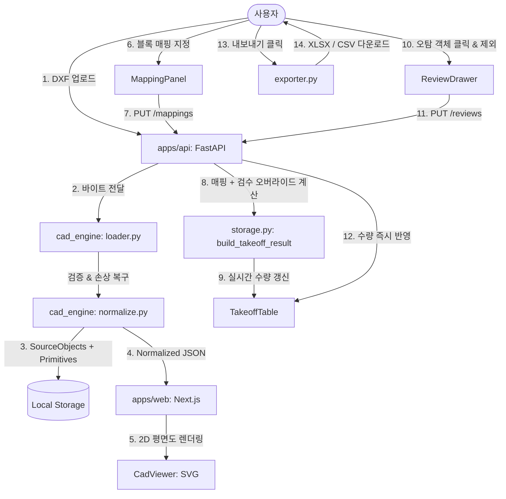

# Electrical AI Platform — Technical Architecture

- **문서 ID:** EAI-ARCH-001
- **버전:** 1.0.0
- **작성자:** A02 Principal Full-Stack Engineering Agent
- **기준 문서:** `docs/PRD.md` (EAI-PRD-001)

---

## 1. 시스템 개요 및 설계 원칙

Electrical AI Platform의 MVP 1은 한국 전기공사 실무자를 위한 **검증 가능한 반자동 DXF 물량산출(Takeoff) 시스템**입니다.

### 핵심 설계 원칙
1. **결정론적 계산과 AI 분리**: CAD 블록 추출, 좌표 변환, 수량 집계는 100% 결정론적 Python 코드로 처리하며, AI가 임의로 수량을 추정하지 않습니다.
2. **역방향 추적성(Traceability)**: 물량산출표의 모든 숫자는 도면 내 단일 `SourceObject`(CAD 핸들/삽입경로/좌표) 또는 명시적인 `ManualObject`로 역추적할 수 있습니다.
3. **원본 도면 불변성**: 업로드된 DXF 파일은 읽기 전용으로 보존되며, 사용자의 매핑, 검수(제외/복원), 수동 추가는 별도의 오버레이 스토리지에 격리 저장됩니다.
4. **투명한 불확실성 노출**: 도면 단위 미설정, 미등록 블록, XREF(외부참조), 중첩/동적 블록은 임의로 확정하지 않고 명확한 경고와 `UNRESOLVED` 상태로 표시합니다.
5. **로컬 우선(Local-First) & 비용 0원**: 인증이나 외부 유료 클라우드 의존성 없이 로컬 환경에서 단독 실행 가능합니다.

---

## 2. 모노레포 구조 및 레이어 분리

```
electrical-ai-platform/
├── apps/
│   ├── web/                    # Next.js 16 + React 19 + Tailwind CSS (App Router)
│   │   ├── src/app/            # 워크스페이스 대시보드 페이지
│   │   ├── src/components/     # CadViewer(SVG 2D), MappingPanel, TakeoffTable, ReviewDrawer
│   │   ├── src/lib/api.ts      # REST API 클라이언트
│   │   └── src/types/cad.ts    # 정규화 도면 및 산출 데이터 타입 정의
│   └── api/                    # FastAPI 서비스 (포트 8000)
│       └── src/eai_api/
│           ├── app.py          # REST 엔드포인트 및 CORS, 예외 핸들링
│           ├── models.py       # Pydantic 데이터 모델
│           ├── storage.py      # 로컬 파일 기반 영속화 스토리지 & 집계 엔진
│           └── exporter.py     # CSV (UTF-8-SIG) 및 XLSX (Multi-sheet) 생성기
├── packages/
│   └── cad_engine/             # 순수 Python 결정론적 CAD 파서 & 정규화 엔진
│       └── src/cad_engine/
│           ├── loader.py       # 안전한 바이트 검증, 크기 제한, DWG 거부, 트렁케이션 방어
│           ├── schema.py       # 정규화 JSON 스키마 v0.1.0
│           ├── normalize.py    # WCS 좌표 변환, INSERT 전개, 렌더 프리미티브 추출
│           ├── takeoff.py      # 결정론적 기호 매핑 및 집계
│           ├── cli.py          # 오프라인 파싱 CLI (`eai-cad parse`)
│           └── testing/        # 독립 정답셋(fixture) 생성기
├── fixtures/dxf/               # 합성 DXF 도면 14종 및 독립 기대값 JSON
├── docs/                       # 기술 문서 및 PRD, ADR
└── pyproject.toml              # uv virtual workspace 설정
```

---

## 3. 데이터 파이프라인 및 워크플로우



---

## 4. CAD 엔진 좌표 및 블록 처리 아키텍처

- **좌표계**: AutoCAD Model Space의 WCS(World Coordinate System)를 기준으로 합니다.
- **INSERT 전개 및 행렬 변환**:
  - `Insert.matrix44()`를 사용하여 부모-자식 블록 좌표계를 결합합니다 (`child @ parent`).
  - 회전, 이동뿐 아니라 **비균일 축척(Non-uniform scale)** 및 **음수 축척(대칭/미러)**을 안전하게 처리합니다.
- **중첩 블록(Nested Blocks)**:
  - 중첩된 블록은 고유의 경로 기반 객체 ID (`{drawing_id}:{h0}/{h1}`)를 부여하여 계층 구조를 보존합니다.
  - P0 기준 기본 정책은 `count_nested=False`이며, A05의 전기공학 규칙 확정 전까지 중복 집계를 방지하기 위해 `UNRESOLVED` 사유로 분리합니다.
- **익명/동적 블록**:
  - 동적 블록 익명 참조(`*U`)는 ezdxf XData `AcDbBlockRepBTag`를 조회하여 원본 블록명을 복원(`effective_block_name`)합니다.
- **외부참조(XREF)**:
  - 외부 참조 블록은 `XREF_UNRESOLVED` 경고를 부여하고 집계에서 제외합니다.
