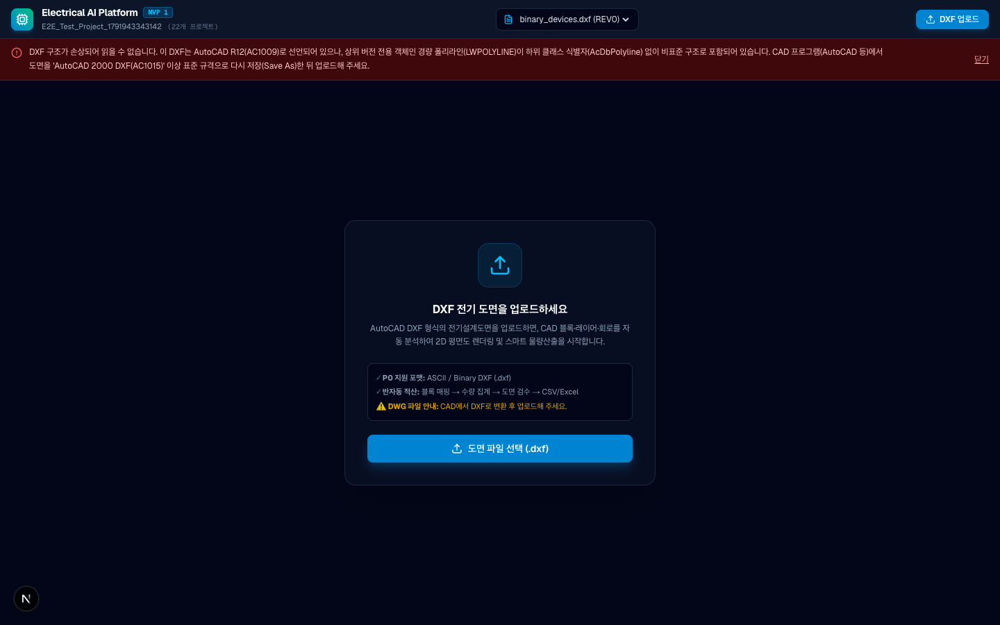
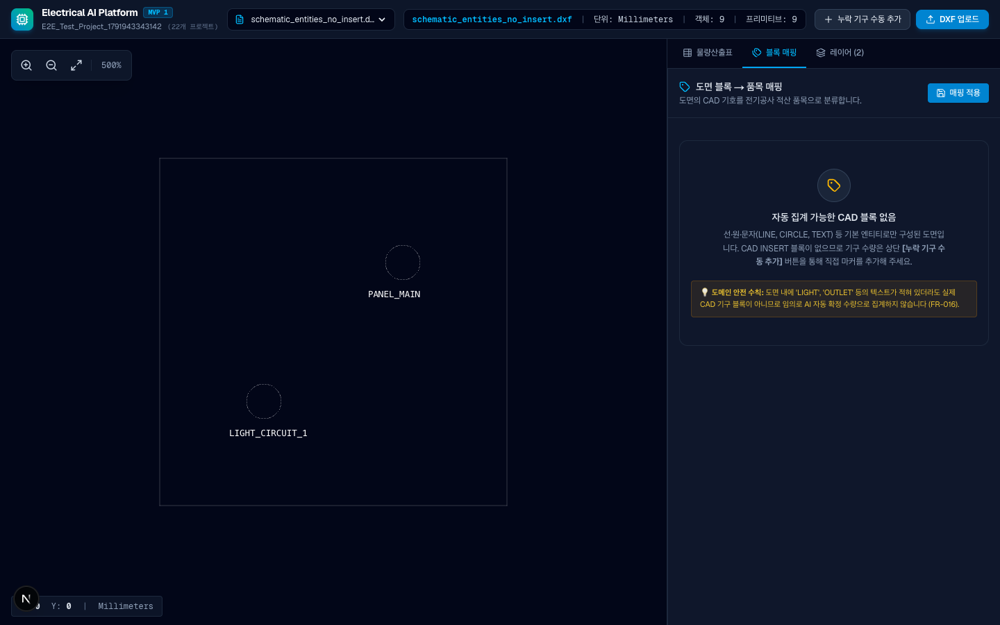

# DXF 호환성 및 R12 비표준 구조 진단 가이드 (Issue #15)

본 문서는 실제 사용자 도면 업로드 시 발생한 `AutoCAD R12(AC1009) 선언 + 비표준 LWPOLYLINE` 실패 사례에 대한 원인 분석, 진단 UX 개선, CAD 재저장(Save As) 가이드 및 향후 비파괴 정규화 방안을 설명합니다.

---

## 1. 문제 현상 및 기술적 원인 (Root Cause)

### 1.1 현상
사용자가 AutoCAD 등에서 내보낸 단선도 DXF 도면(`electrical-schematic.dxf`)을 플랫폼에 업로드했을 때, 시스템이 범용 오류 메시지인 `"DXF 구조가 손상되어 읽을 수 없습니다."`를 반환하며 적산이 중단되었습니다.

### 1.2 기술적 원인 분석
- **선언 버전과 객체 규격의 불일치:**
  - DXF 헤더 `$ACADVER`는 **`AC1009` (AutoCAD Release 12, 1992년 발표 규격)**로 선언되어 있었습니다.
  - 그러나 도면 본문(`ENTITIES`) 내부에는 R13(1994년) 이후 도입된 **경량 폴리라인(`LWPOLYLINE`)** 객체가 포함되어 있었습니다.
- **필수 하위 클래스 식별자(Subclass Marker) 부재:**
  - R13+ 객체는 DXF 그룹 코드 `100` 및 하위 클래스 식별자(`AcDbEntity`, `AcDbPolyline`)를 필수로 가져야 하지만, 해당 파일은 식별자 마커가 누락된 채 R12 형식으로 저장되었습니다.
- **파서 동작:**
  - 업계 표준 DXF 엔진(`ezdxf.recover`)은 파일 구조 무결성 검증 시 `DXFStructureError: missing 'AcDbPolyline' subclass in LWPOLYLINE(#None)`를 발생시키며 중단합니다.

---

## 2. A02 진단 UX 개선 (비파괴적이고 정직한 오류 안내)

기존의 모호한 에러 메시지 대신, **원인과 사용자의 구체적 조치 방법(Actionable Guidance)**을 직관적으로 연결하여 제공합니다.

### 2.1 진단 메시지 계약
비표준 R12 + LWPOLYLINE 누락이 감지되면 화면 상단 배너 및 API 응답에 다음 진단이 표시됩니다:

> **"DXF 구조가 손상되어 읽을 수 없습니다. 이 DXF는 AutoCAD R12(AC1009)로 선언되어 있으나, 상위 버전 전용 객체인 경량 폴리라인(LWPOLYLINE)이 하위 클래스 식별자(AcDbPolyline) 없이 비표준 구조로 포함되어 있습니다. CAD 프로그램(AutoCAD 등)에서 도면을 'AutoCAD 2000 DXF(AC1015)' 이상 표준 규격으로 다시 저장(Save As)한 뒤 업로드해 주세요."**

### 2.2 진단 화면 증거
> *참고: 본 증거 화면은 A02 로컬 Chrome 환경에서 E2E 스크립트(`e2e_r12_runner.mjs`)를 통해 실측 캡처되었습니다 (CI 헤드리스 환경이 아닌 실제 브라우저 렌더링 검증).*

---

## 3. 사용자 CAD 재저장(Save As) 가이드

본 PR #16은 사용자의 원본 파일을 임의로 침묵 변환(silent normalization)하지 않고, 파일 구조의 손상 없이 CAD 프로그램의 네이티브 표준 변환 기능을 활용하도록 안내하는 **행동 지침(Actionable Guidance)**을 제공합니다.

사용자는 사용 중인 CAD 프로그램에서 30초 이내에 표준 규격으로 도면을 다시 저장하여 즉시 정상 업로드할 수 있습니다.

### 3.1 AutoCAD / AutoCAD LT
1. 도면을 엽니다.
2. 상단 메뉴에서 **파일(File) → 다른 이름으로 저장(Save As)**을 선택합니다.
3. 파일 형식 드롭다운에서 **AutoCAD 2000/LT2000 DXF (*.dxf)** 또는 **AutoCAD 2018 DXF (*.dxf)**를 선택합니다.
   - ※ `AutoCAD R12/LT2 DXF (*.dxf)`는 선택하지 마십시오.
4. 단위를 **밀리미터(mm)**로 확인하고 저장한 후 플랫폼에 업로드합니다.

### 3.2 ZWCAD / BricsCAD / GstarCAD
1. 명령창에 `SAVEAS`를 입력합니다.
2. 파일 형식을 **2000 DXF** 또는 **2013/2018 DXF**로 설정하여 저장합니다.

---

## 4. INSERT=0 도면 안내 및 도메인 안전 수칙 (FR-016)

재저장 후 업로드 시, 도면이 CAD 블록(`INSERT`) 없이 기본 선(`LINE`), 원(`CIRCLE`), 문자(`TEXT`)로만 작성된 단선도인 경우의 처리 원칙입니다.

### 4.1 UI 빈 상태 안내 (Empty State)
- 블록 매핑 탭에 다음과 같이 명확한 안내를 제공합니다:
  > **"자동 집계 가능한 CAD 블록 없음"**  
  > 선·원·문자(LINE, CIRCLE, TEXT) 등 기본 엔티티로만 구성된 도면입니다. CAD INSERT 블록이 없으므로 기구 수량은 상단 **[누락 기구 수동 추가]** 버튼을 통해 직접 마커를 추가해 주세요.

### 4.2 도메인 안전 수칙 준수 (FR-016)
- 도면 내에 `'LIGHT'`, `'OUTLET'`, `'전등'` 등의 텍스트 라벨이 적혀 있더라도, **텍스트를 임의로 AI 자동 확정 수량으로 집계하지 않습니다**.
- 단선도나 기구 기호가 단순 선/원으로 그려진 도면은 사용자가 화면을 보며 **[누락 기구 수동 추가]** 모드로 정확한 위치에 수동 마커(EA)를 등록하여 안전하게 적산표를 산출합니다.

### 4.3 블록 없는 도면 뷰어 증거

---

## 5. 비파괴 DXF 정규화(Normalization) 후속 제안 (PR 범위 외)

PR #16의 범위는 진단 및 Save-As 가이드이며, 자동 복구는 원본 무결성을 침해하지 않도록 향후 제안으로 관리합니다.
현재 시스템은 사용자 원본 파일의 무결성을 존중하며 임의의 침묵 수정(silent modification)을 수행하지 않습니다. 향후 비표준 도면을 플랫폼 차원에서 구제하기 위한 안전 원칙은 다음과 같습니다:

1. **원본 Raw 보존 (불변 원칙):**
   - 사용자가 업로드한 원본 바이트는 항상 그대로 보존되어 다운로드 가능해야 함 (`storage/raw.dxf`).
2. **명시적 Opt-In 변환:**
   - 비표준 구조 감지 시 "표준 DXF 2000 규격으로 자동 변환하여 열기" 옵션을 사용자에게 명시적으로 확인받고 진행.
3. **엔티티 무손실 검증 (Audit Comparison):**
   - 변환 전후의 엔티티 개수(라인 17개, 텍스트 14개, 원 5개, 폴리라인 5개 등)와 기하 구조가 100% 일치하고 `audit errors == 0`임을 상호 검증한 후 표시.
