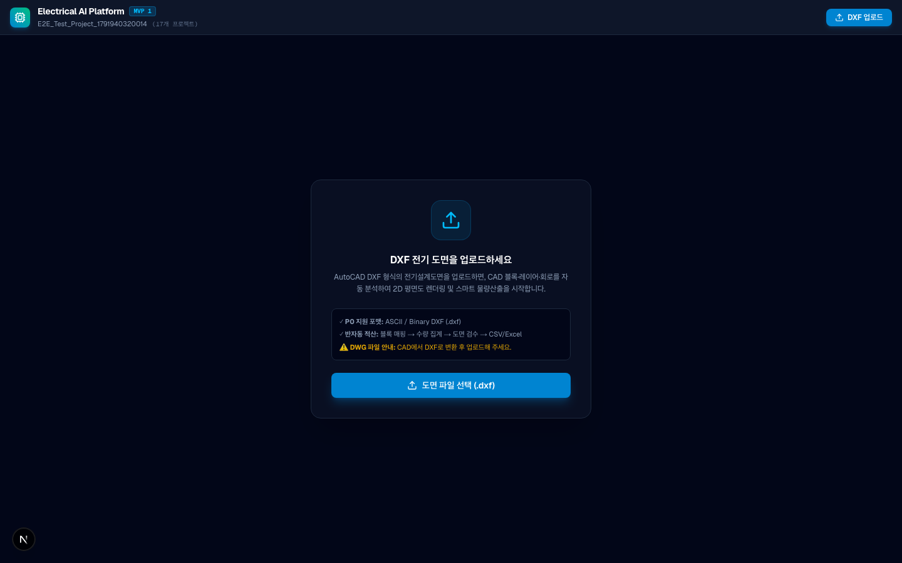
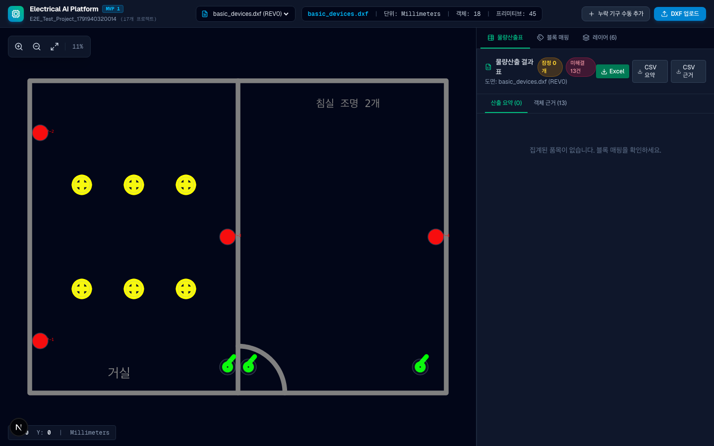
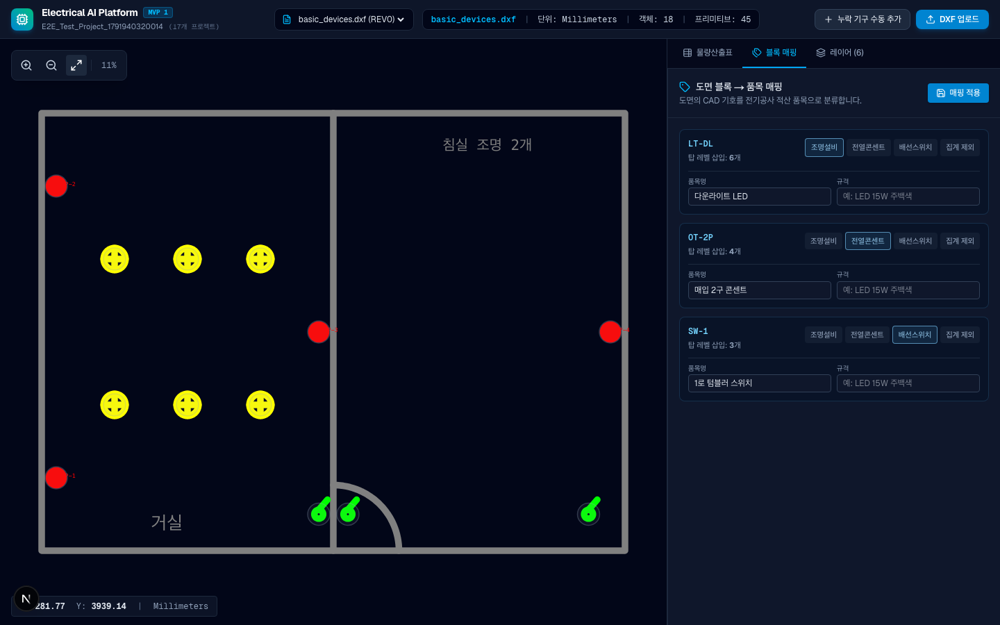
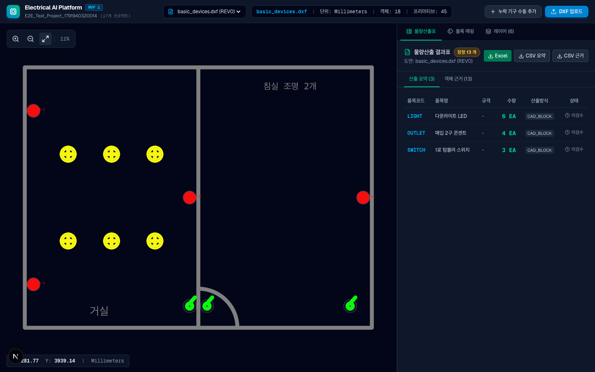
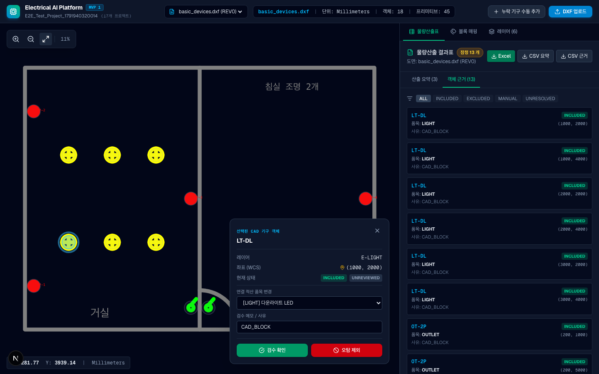
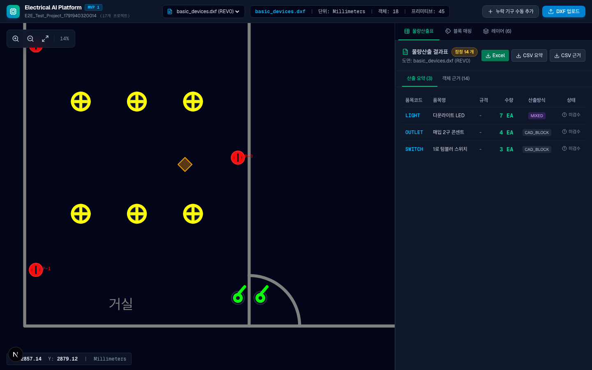

# PO를 위한 전기공사 AI 플랫폼 사용자 시연 가이드 (v0.1.0)

> **문서 ID:** EAI-GUIDE-001  
> **대상:** Product Owner (PO), 도메인 엔지니어, 품질 관리자  
> **기준 환경:** 로컬 개발 환경 (`macOS` / `Linux`)  
> **접속 URL:** `http://localhost:3000` (웹 대시보드) / `http://127.0.0.1:8000/docs` (API 문서)  
> **대표 시연 샘플 도면:** `fixtures/dxf/basic_devices.dxf` (안전한 합성 DXF)  

---

## 1. 개요 및 사전 준비

본 가이드는 PO가 로컬 환경에서 단 한 번의 명령으로 플랫폼을 구동하고, 8단계의 핵심 사용자 경험(프로젝트 생성부터 도면 분석, 기호 매핑, 양방향 하이라이트, 검수 제외/복원, 수동 기구 추가, CSV/XLSX 내보내기)을 5분 이내에 직접 검증할 수 있도록 작성된 단계별 매뉴얼입니다.

### 1.1 사전 요구 조건
- **운영체제:** macOS (Apple Silicon/Intel) 또는 Ubuntu/Debian Linux
- **도구:** Python 3.12 이상, Node.js 20 이상
- **접속 환경:** 로컬 웹 브라우저 (Google Chrome 권장)
  > ⚠️ **주의:** 본 플랫폼은 1인 로컬 실행 전용으로 동작하며, `http://localhost:3000`은 본인 컴퓨터에서만 접속 가능합니다 (외부 퍼블릭 URL 아님).

### 1.2 원클릭 실행 명령
터미널에서 저장소 루트 디렉토리로 이동한 후 아래 스크립트를 실행합니다:

```bash
./scripts/dev-start.sh
```

- 스크립트가 실행 환경(Python 3.12+, Node 20+, 포트 8000/3000)을 자동 진단한 후 API 서버와 웹 앱을 동시에 띄웁니다.
- 브라우저를 열고 **`http://localhost:3000`**에 접속합니다.
- 시연 종료 시 터미널에서 **`Ctrl + C`**를 누르거나, 별도 터미널에서 **`./scripts/dev-stop.sh`**를 실행하면 안전하게 정리됩니다.

---

## 2. 대표 시연 도면 사양 (`fixtures/dxf/basic_devices.dxf`)

본 시연에 사용하는 `basic_devices.dxf`는 상용 기밀이 일체 포함되지 않은 100% 자체 제작 합성 DXF 테스트 픽스처입니다.

| 블록 이름 | 도면 내 엔티티 수 | 권장 매핑 품목 | 정규 단위 | 기준 규격/비고 |
|:---|:---:|:---|:---:|:---|
| **`LT-DL`** | 6개 | `LIGHT` (전등) | `EA` | 다운라이트 LED 6인치 매입등 |
| **`OT-2P`** | 4개 | `OUTLET` (전열) | `EA` | 2구 매입 접지 콘센트 (회로 속성 `P-1`) |
| **`SW-1`** | 3개 | `SWITCH` (스위치) | `EA` | 1구 텀블러 벽체 매입 스위치 |
| **합계** | **13개** | - | `EA` | **정상 도면 기구 총 13 EA** |

---

## 3. 초고속 실전 데모 (원클릭 시연 모드 - 추천)

PO 및 평가자가 개별 파일 업로드 없이 전체 통합 기능을 3분 내에 체험할 수 있는 원클릭 실전 데모 시드가 준비되어 있습니다.


1. **`./scripts/dev-start.sh`** 실행 후 브라우저 `http://localhost:3000`에 접속합니다.
2. 헤더 우측의 **`[⚡ 실전 데모 프로젝트 불러오기]`** 버튼을 클릭합니다.
3. 약 1초 내에 **실전 데모 프로젝트(`proj_cbd9b3ed`)**가 활성화되며 3종 도면이 즉시 탑재됩니다:
   - **`floorplan_sample.png`**: 2D 래스터 평면도 (조명 4, 콘센트 2, 스위치 2)
   - **`basic_devices.dxf`**: 표준 CAD 기구 배치도 (13개 기구)
   - **`pdf_c_vector_features.pdf`**: 다중 페이지 벡터 PDF 도면
4. **기호 검색 시연**:
   - 상단 도면 드롭다운에서 `floorplan_sample.png` 선택.
   - 우측 상단 툴바에서 **`[기호 검색]`** 탭 클릭.
   - 도면 캔버스에서 노란색 조명 원형 기호를 **마우스로 드래그**하여 영역 지정.
   - **`[기호 검색 실행]`** 클릭 $\rightarrow$ 도면 전체에서 유사 조명 기호 270여 개 실시간 탐지 및 캔버스 마커 렌더링.
   - 기호 목록에서 첫 번째 기호 선택 후 키보드 **`R` (반려)** 및 **`A` (승인)** 단축키 입력 $\rightarrow$ 상태 뱃지 실시간 전이 확인.
   - **`[모두 승인]`** 클릭 후 **`[물량산출표]`** 탭으로 이동하여 `LIGHT` 수량 확인.
   - **`[Excel 내보내기]`** 클릭하여 2개 시트(`Takeoff Summary` + `Takeoff Evidence`) 완성 확인.

---

## 4. 정규 8단계 시연 시나리오 및 클릭 가이드


---

### [1단계] 프로젝트 생성
1. 브라우저에서 `http://localhost:3000`에 접속합니다.
2. 좌측 상단 프로젝트 드롭다운 옆 **`+ 새 프로젝트`** 버튼을 클릭합니다.
3. 프로젝트 이름에 `PO_시연_기본전등전열`을 입력하고 **`생성`**을 누릅니다.
- **예상 화면:** 상단 헤더에 `PO_시연_기본전등전열` 프로젝트가 활성화되며, "분석할 DXF 도면을 업로드하세요" 안내 화면이 표시됩니다.
- **실패 시 확인:** 백엔드 API 콘솔 로그(`/tmp/eai_api.log`)에서 8000번 포트 연결 상태를 확인하세요.



---

### [2단계] DXF 도면 업로드
1. 우측 상단 파란색 **`DXF 업로드`** 버튼을 클릭합니다.
2. 파일 선택 창에서 저장소의 **`fixtures/dxf/basic_devices.dxf`** 파일을 선택합니다.
- **예상 화면:** 
  - 약 0.5초 이내에 도면 파싱이 완료되고 2D SVG CAD 뷰어 화면에 벽체(Line), 문(Arc), 조명·콘센트·스위치(Circle) 기호가 벡터 그래픽으로 선명하게 렌더링됩니다.
  - 상단 탭에 `basic_devices.dxf (REV0)`가 생성됩니다.
- **실패 시 확인:** 50 MiB 초과 파일이거나 유효하지 않은 파일일 경우 상단에 경고 배너가 표시됩니다. `fixtures/dxf/basic_devices.dxf`를 선택했는지 확인하세요.



---

### [3단계] CAD 뷰어 줌 / 팬 / 레이어 탐색
1. **마우스 휠**을 위/아래로 굴려 도면을 확대 및 축소합니다.
2. **마우스 왼쪽 버튼**을 누른 채 도면을 드래그하여 이동(Pan)합니다.
3. 도면 우측 상단의 툴바에서:
   - **`+` (Zoom In)** / **`-` (Zoom Out)** 버튼 클릭.
   - **`[ ]` (화면 맞춤 / Fit-to-Screen)** 버튼을 눌러 초기 화면 비율로 복원합니다.
4. 좌측 도면 목록 하단의 **레이어(Layers) 토글** 버튼을 클릭하여 `WALL`, `LIGHT`, `OUTLET` 레이어를 껐다 켜봅니다.
- **예상 화면:** 부드러운 반응속도로 뷰포트가 실시간 변환되며, 체크 해제된 레이어의 요소가 캔버스에서 즉시 숨겨집니다.

---

### [4단계] 기호-품목 블록 매핑
1. 우측 패널의 **`블록 매핑`** 탭을 클릭합니다.
2. 도면에서 자동 추출된 3개 블록에 대해 드롭다운을 지정합니다:
   - **`LT-DL` (6개)** $\rightarrow$ **`LIGHT`** (전등 (다운라이트/평판등)) 선택
   - **`OT-2P` (4개)** $\rightarrow$ **`OUTLET`** (전열 (매입 콘센트)) 선택
   - **`SW-1` (3개)** $\rightarrow$ **`SWITCH`** (스위치 (텀블러 스위치)) 선택
3. **`매핑 규칙 저장 및 산출`** 버튼을 클릭합니다.
- **예상 화면:** "매핑 규칙이 저장되었습니다" 알림과 함께 즉시 물량산출 집계가 재계산됩니다.



---

### [5단계] 산출 수량표 및 양방향 하이라이트 확인
1. 우측 패널의 **`물량 산출표`** 탭을 클릭합니다.
2. 산출 요약표에서 다음 수량을 확인합니다:
   - `LIGHT`: **6 EA** (산출 방식: `CAD_BLOCK`)
   - `OUTLET`: **4 EA** (산출 방식: `CAD_BLOCK`)
   - `SWITCH`: **3 EA** (산출 방식: `CAD_BLOCK`)
   - **총합:** **13 EA**
3. 산출표에서 `LIGHT` 행을 마우스로 클릭합니다.
- **예상 화면:** 
  - 도면 캔버스에서 6개의 다운라이트 원형 기호 테두리가 **황금색/청색 하이라이트**로 빛납니다.
  - 도면에서 임의의 기호(예: 콘센트 원형)를 클릭하면 우측 하단에 **검수 상세 드로어(Review Drawer)**가 열리며 해당 기호의 WCS 좌표와 속성(예: `CIRCUIT: P-1`)이 표시됩니다.



---

### [6단계] 검수 드로어에서 오탐 제외 및 복원 (False Positive Review)
1. 도면에서 조명 기호 1개를 클릭하여 검수 드로어를 엽니다.
2. 사유에 `현장 미설치 대상`을 입력하고 **`오탐 제외`** 버튼을 누릅니다.
   - **검증:** 산출표의 `LIGHT` 수량이 **6 EA $\rightarrow$ 5 EA**로 즉시 감소합니다.
3. 다시 제외된 조명 기호를 도면에서 선택한 후 **`집계에 복원`** 버튼을 누릅니다.
   - **검증:** 산출표의 `LIGHT` 수량이 **5 EA $\rightarrow$ 6 EA**로 즉시 복원됩니다.



---

### [7단계] 누락 기구 수동 추가 및 삭제 (Field Manual Marker)
1. 상단 헤더의 **`누락 기구 수동 추가`** 버튼을 클릭하여 활성화합니다 (주황색 활성화 상태).
2. 도면 캔버스에서 조명이 설치될 빈 벽체나 천장 지점을 클릭합니다.
3. 팝업되는 모달 창에서:
   - **품목 선택:** `LIGHT` 선택 (정규 단위: `EA` 표시 확인)
   - **사유:** `도면 누락` 선택
   - **상세 메모:** `현장 복도 조명 증설분` 입력
   - **`수동 기구 등록`** 버튼을 클릭합니다.
4. **검증:**
   - 도면에 주황색 십자 수동 마커가 생성됩니다.
   - 산출표의 `LIGHT` 수량이 **6 EA $\rightarrow$ 7 EA**로 증가하며, 산출 방식이 `CAD_BLOCK`에서 **`MIXED`**로 전환됩니다.
5. 등록된 수동 마커를 클릭하고 검수 드로어에서 **`수동 기구 삭제`**를 누릅니다.
   - **검증:** 수량이 즉시 **7 EA $\rightarrow$ 6 EA**로 롤백되고 마커가 제거됩니다.



---

### [8단계] CSV / XLSX 내보내기 및 새로고침 영속성 확인
1. 상단 헤더 우측의 **`CSV 내보내기`** (요약 / 근거) 및 **`Excel (XLSX) 내보내기`** 버튼을 클릭하여 파일을 다운로드합니다.
2. 다운로드된 엑셀 파일을 열어봅니다:
   - `Takeoff Summary` 시트: 품목별 수량, 단위(`EA`), 산출 방식(`CAD_BLOCK`), 검수 상태 확인.
   - `Takeoff Evidence` 시트: 13개 전체 기호의 WCS 좌표(X, Y), 블록명, 검수 사유가 1행씩 기록되어 있는지 확인.
3. 브라우저에서 **`F5` (새로고침)**를 누릅니다.
   - **검증:** 새로고침 후에도 프로젝트, 업로드 도면, 매핑 규칙, 산출 결과가 그대로 유지됩니다.


---

## 4. 자주 묻는 질문 및 문제 해결 체크리스트

| 증상 | 원인 | 조치 방법 |
|:---|:---|:---|
| 브라우저에서 `localhost:3000` 접속 불가 | 프론트엔드 미실행 | 터미널에서 `./scripts/dev-start.sh` 실행 여부 확인 |
| "도면 분석 중..." 상태에서 멈춤 | API 백엔드(8000) 미응답 | `curl http://127.0.0.1:8000/api/health` 확인 |
| 업로드 시 "DWG 파일은 현재 지원하지 않습니다" | DWG 확장자 파일 업로드 | AutoCAD 등에서 DXF(ASCII 또는 Binary)로 내보낸 후 업로드 |
| 산출 상태가 `잠정 (Provisional)`으로 표시됨 | 도면 범위 미검증 기본 안전 정책 | **정상 동작입니다 (ADR-005/DEC-013).** 도면 범례/공사 범위 공식 승인 전까지 안전을 위해 잠정 상태로 유지됩니다. |
| 포트 충돌 오류 발생 | 이전 프로세스가 잔존함 | `./scripts/dev-stop.sh` 실행 후 `./scripts/dev-start.sh` 재실행 |

---

## 5. 피드백 및 문의
- **기술 책임 (A02):** GitHub Pull Request #1 / Issue #11 댓글을 통해 문의 및 피드백을 전달해 주시면 즉시 조치하겠습니다.
